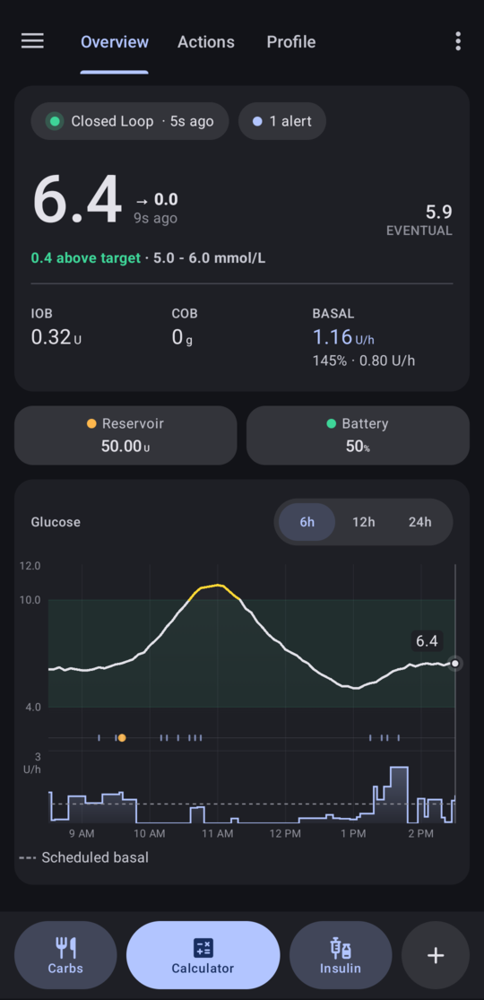
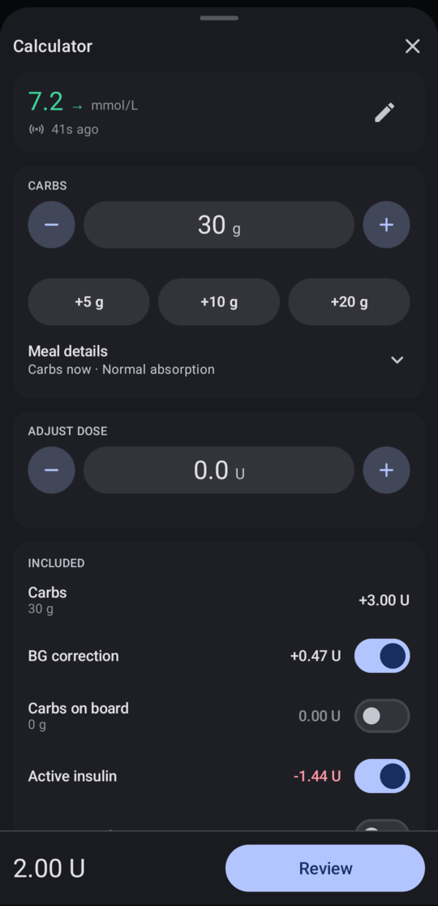
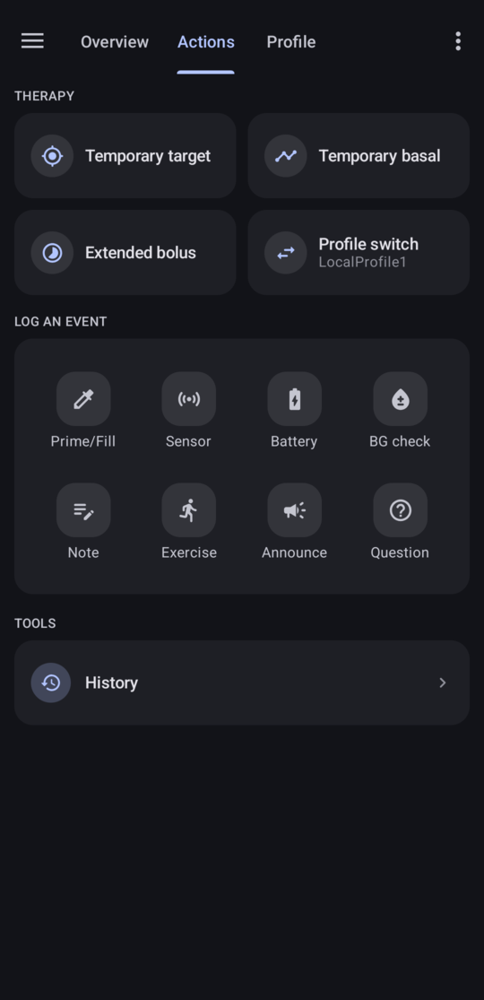

# AndroidAPS experimental fork

> [!WARNING]
> This fork contains highly experimental insulin-dosing code that is not part of upstream AndroidAPS,
> has not been through the AAPS review process and is **not clinically validated**. It is not affiliated
> with or endorsed by AndroidAPS, the Nightscout Foundation, Ypsomed or CamDiab.
> If you need a supported system, use [upstream AndroidAPS](https://github.com/nightscout/AndroidAPS).

This is a fork of [AndroidAPS](https://github.com/nightscout/AndroidAPS) with a redesigned native Android
UI and YpsoPump support.

  
  
  

## What this fork changes

- A redesigned interface for home, dosing, loop control, history, statistics, profile and settings.
- [YpsoPump](pump/ypsopump/README.md) support: boluses, temporary basals and pump history, in open and
  closed loop.
- A dose adjustment in the Calculator, to add or remove units from the calculated dose.

## Upstream AndroidAPS

Most of the app is still AndroidAPS. For everything else, see the
[AndroidAPS documentation](https://wiki.aaps.app/en/latest/). It describes upstream AndroidAPS, so it may
not match the changes above.

## Install

See [Building the app](docs/building.md).

## Project status

As of October 2026, all modernization and new feature development is suspended and waiting for stable AndroidAPS 4.0 release.
Current work is limited to bug fixes and YpsoPump driver improvements.

## Licence

Licensed under AGPL-3.0; see [LICENSE.txt](LICENSE.txt). No warranty is provided.
